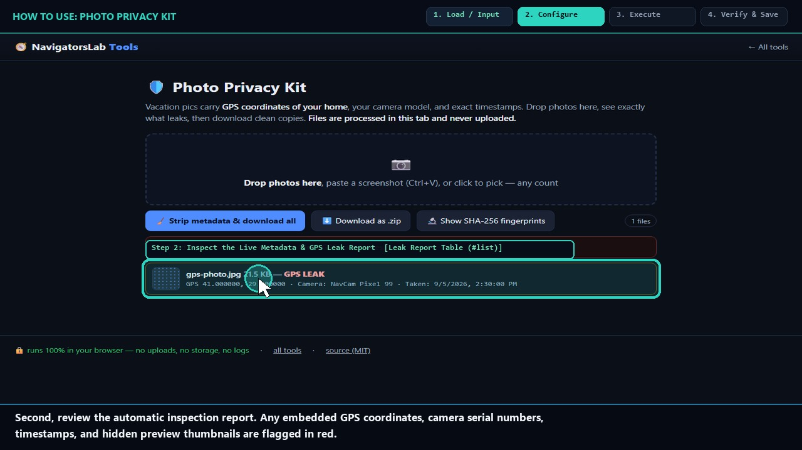
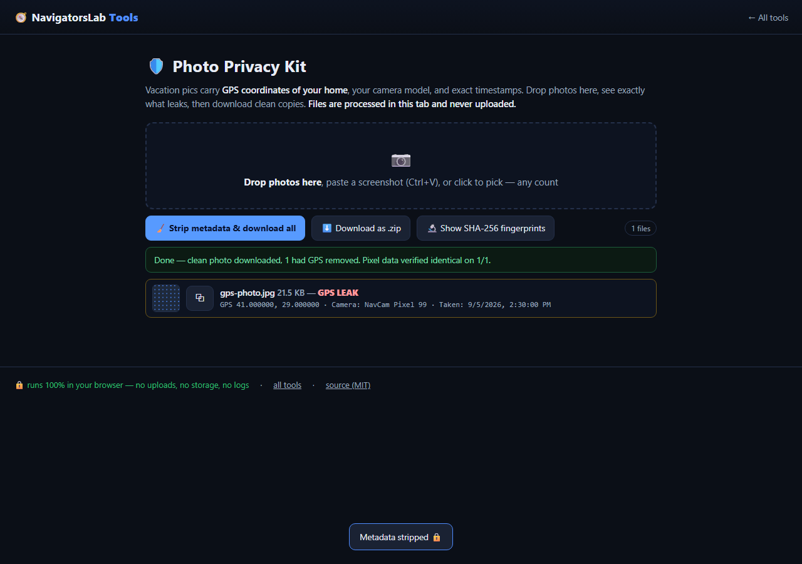

# 🛡 Photo Privacy Kit

> Strip GPS, camera model and timestamps before posting

     

<h4 align="center">
  &#9654; <a href="https://navigatorslab.com/tools/exif.html">Open it on navigatorslab.com</a> &mdash; free, no sign-up, nothing uploaded<br>
  <a href="https://navigatorslab.com/Photo-Privacy-Kit">navigatorslab.com/Photo-Privacy-Kit</a> &middot; <a href="https://navigatorslab.com/tools/videos/exif.mp4">🔊 Watch Narrated Step-by-Step Tutorial Video</a> &middot; <a href="https://navigatorslab.com/tools/videos/notebooklm-overview.mp4">Watch Full Suite Hands-On Video</a><br>
  This repo's Pages site runs the <em>actual tool</em>: <code>demo.html</code>
</h4>



Strip GPS, camera and timestamps before posting — plus SHA-256 fingerprints so you can prove the cleaned file is pixel-identical. Paste a screenshot with Ctrl+V.

## 📖 Complete Step-by-Step User Guide

### Step 1: Load Your Photo (Drag & Drop or Ctrl+V) (`Dropzone (#dz) or Clipboard Paste`)
- **How to do it:** Open Photo Privacy Kit and drag one or more JPEG, PNG, or WebP images onto the main dropzone (`#dz`), click to browse your device, or press `Ctrl+V` (`Cmd+V` on Mac) to paste directly from your clipboard.
- **Expected result:** The file loads immediately into browser memory with zero network activity.

### Step 2: Inspect the Live Metadata & GPS Leak Report (`Leak Report Table (#list)`)
- **How to do it:** Read the per-file inspection row under `#list`. Red warning badges highlight high-risk leaks such as exact GPS latitude/longitude coordinates, device make/model, capture timestamps, and embedded EXIF thumbnails.
- **Expected result:** Every detected EXIF, XMP, IPTC, and comment segment is listed byte-by-byte.

### Step 3: Strip Metadata & Toggle SHA-256 Pixel Proof (`Strip Button (#strip) & SHA-256 Toggle`)
- **How to do it:** Optionally toggle **Show SHA-256 fingerprints** to display the decoded RGBA pixel hash before and after cleaning. Click **Strip metadata & download all (`#strip`)** (or **Download as .zip** for batches).
- **Expected result:** The segment parser strips APP1/APP13/XMP/COM markers without re-encoding your pixels.

### Step 4: Verify GPS CLEAR & Save Cleaned Image (`Verified Output Row (GPS CLEAR)`)
- **How to do it:** Verify that the status badge turns green (**GPS CLEAR — 0 metadata segments**) and that the before/after decoded pixel SHA-256 hashes match 100%.
- **Expected result:** Cleaned `.clean.jpg` / `.png` / `.webp` saved locally with zero generation loss.

## 🎛️ UI Controls, Shortcuts & Parameters Reference

| Control / Shortcut | What It Does |
|---|---|
| `Dropzone (`#dz`) / `Ctrl+V`` | Accepts single or batch `.jpg`, `.jpeg`, `.png`, and `.webp` files via drag-and-drop, file picker, or clipboard paste. |
| `Strip metadata & download all (`#strip`)` | Removes EXIF, GPS, XMP, IPTC, and comment segments from every loaded file and downloads cleaned copies. |
| `Download as .zip (`#zip`)` | Bundles all cleaned images into a single local `.zip` archive when processing multiple photos. |
| `Show SHA-256 fingerprints (`#shaToggle`)` | Computes the SHA-256 digest of the decoded pixel buffer before and after stripping to prove zero pixel alteration. |

## 💡 Pro Tips & Real-World Workflows

- 💡 Press `Ctrl+V` right after taking a system screenshot to strip OS color-profile and timestamp chunks before sharing on Slack, Discord, or GitHub issues.
- 💡 Because Photo Privacy Kit strips container markers at the byte level without re-compressing JPEG blocks, your photo never suffers JPEG generation loss.
- 💡 Drop a cleaned `.clean.jpg` file back into the dropzone at any time to confirm it reports `0 metadata segments`.

## 🧪 Concrete Example: Input → Engine → Output

| Stage | What Happens | Details |
|---|---|---|
| **1. Raw Input** | **vacation-photo.jpg (3.4 MB)** | Hidden EXIF: GPS 41.0082° N, 28.9784° E · iPhone 15 Pro · 2026:08:14 14:22:09 · Embedded 160x120 thumbnail |
| **2. On-Device Engine** | **Byte-level JPEG APP1/APP13/COM parser strips 64 KB of metadata segments without decoding or re-encoding pixels** | Runs 100% client-side in your browser tab under strict `CSP` (`connect-src 'none'`). |
| **3. Verified Output** | **vacation-photo.clean.jpg (3.34 MB)** | 0 EXIF/GPS/XMP/IPTC segments · Pixel SHA-256: 9f84c2...e10b (100% byte-identical image data) |

```text
GPS: REMOVED | Camera: REMOVED | Thumbnail: REMOVED | Pixels SHA-256: IDENTICAL [OK]
```

- 🔊 **Narrated Step-by-Step Usage Tutorial Video (`43s`):** [`demo.mp4`](./demo.mp4) (also live at [`https://navigatorslab.com/tools/videos/exif.mp4`](https://navigatorslab.com/tools/videos/exif.mp4))
- 🎬 **Full Suite Hands-On Video Guide:** [`https://navigatorslab.com/tools/videos/notebooklm-overview.mp4`](https://navigatorslab.com/tools/videos/notebooklm-overview.mp4)

## ✅ What it does

- See exactly what leaks — GPS coordinates, camera & lens, timestamps, embedded thumbnails — before you post
- One-click clean copy: Exif, XMP, IPTC and comments removed, pixels untouched
- SHA-256 fingerprints + pixel comparison prove the clean file is the same picture, minus the data
- Paste screenshots directly (Ctrl/Cmd+V) or drop files; batch friendly

## 🚀 Try it in 30 seconds

1. Drop a photo (or paste a screenshot with Ctrl/Cmd+V)
2. Read the leak report: GPS, camera, timestamps, thumbnails
3. Hit strip &amp; download — the SHA-256 proves pixels are unchanged

## 📸 Live UI in action



## 🔒 Private by design

- **100% on-device** — files are processed in your browser and **never uploaded** to any server
- **No accounts, no tracking, no cookies, nothing retained** — open the page and work
- **Works offline** once loaded; fully mobile-friendly
- **Free & open source (MIT)** — use it at home, at work, anywhere

## 🤖 Built for humans *and* AI agents

- Deep-linkable via URL parameters — see the [Agent Mode guide](https://navigatorslab.com/tools/agents.html)
- Machine-readable catalog: [llms.txt](https://navigatorslab.com/tools/llms.txt) · [llms-full.txt](https://navigatorslab.com/tools/llms-full.txt)
- MCP endpoint: `POST https://navigatorslab.com/tools/mcp` (tool catalog + deterministic text tools — see the [main repo](https://github.com/Kayforkind/NavigatorsLab-Tools))
- No build step required to *use* any tool — just the URL

## 🛠 Under the hood

Hand-written JPEG/PNG/WebP segment parsers — no library touches your pixels

Third-party components are catalogued in [NOTICE](NOTICE); this repo is MIT-licensed ([LICENSE](LICENSE)).

## 🗂 The NavigatorsLab Tools suite

The full catalog — every tool in the hub with the same zero-upload promise, plus the lab's apps, CLIs and engines:

| Tool | What it does | |
|---|---|---|
| **🛡 Photo Privacy Kit** | Strip GPS, camera model and timestamps before posting | [Open](https://navigatorslab.com/tools/exif.html) |
| 🔐 Password Breach Checker | Has this password been breached? — it never leaves your tab | [Open](https://navigatorslab.com/tools/breachcheck.html) |
| 🔍 Metadata & Hidden-Data Checker | See what's really inside a file — then strip it | [Open](https://navigatorslab.com/tools/metadata.html) |
| 🗜 Image Shrinker | Hit “max 2 MB” portal limits without TinyPNG | [Open](https://navigatorslab.com/tools/shrink.html) |
| 📄 Scan & Screenshot Cleaner | Phone photos of documents → clean, straight PDFs | [Open](https://navigatorslab.com/tools/scan.html) |
| ✍ Local E-Sign Pad | Sign this lease tonight — not DocuSign | [Open](https://navigatorslab.com/tools/sign.html) |
| 🧾 Receipts → One PDF | Shoebox of receipt photos → one date-sorted PDF | [Open](https://navigatorslab.com/tools/receipts.html) |
| 🔢 Receipt OCR → CSV | Read totals off receipt photos, export for expenses | [Open](https://navigatorslab.com/tools/ocr.html) |
| 🔳 QR Studio | Generate QR codes and decode QR images — no site sees them | [Open](https://navigatorslab.com/tools/qr.html) |
| 🎧 Audio Trimmer | Cut voice notes and clips on a waveform | [Open](https://navigatorslab.com/tools/audio.html) |
| 🧮 Invoice / Quote Generator | One-person shops: hours in, clean PDF out | [Open](https://navigatorslab.com/tools/invoice.html) |
| 🗂 Batch Rename & Sort | IMG_5847.jpg → 2026-09-05-receipt-home-depot.jpg | [Open](https://navigatorslab.com/tools/rename.html) |
| 🖨 Print-Shop Prep | Exact sizes, bleed, DPI checks, print-ready PDF | [Open](https://navigatorslab.com/tools/printprep.html) |
| 📑 PDF Pages | Reorder, rotate, delete and extract PDF pages | [Open](https://navigatorslab.com/tools/pdfpages.html) |
| 🔬 Text Diff | Compare two texts with word-level highlights | [Open](https://navigatorslab.com/tools/textdiff.html) |
| 🎨 Reimagine | Redesign any HTML page from its own content | [Open](https://navigatorslab.com/reimagine/) |
| 📊 Text Stats | Words, reading time, readability, keyword density | [Open](https://navigatorslab.com/tools/textstats.html) |
| 📜 PDF Studio | Edit the text inside your PDF — private, free, open source | [Open](https://navigatorslab.com/pdf-studio/) |
| 🩺 Design Health | 18 deterministic design-quality checks for HTML — no LLM, no API key | [Open](https://github.com/Kayforkind/design-health-action) |
| 🔪 Skill Slice | Copy one Read-verified skill folder — a slice, not the pie | [Open](https://github.com/Kayforkind/skill-slice) |
| 🕵 liecatchers | Your agent said Done. Prove it — ten sensors, one RECEIPT.json | [Open](https://github.com/Kayforkind/liecatchers) |
| 📚 Book Guide MCP | Ship improvements with your books — agents cite, run playbooks, learn | [Open](https://github.com/Kayforkind/book-guide-mcp) |
| 📡 Data Insights | Founder intelligence — daily & weekly tech signal briefs | [Open](https://github.com/Kayforkind/data-insights) |
| 🪓 Iron Axe: Legacy | An original side-scrolling beat 'em up — Godot 4 | [Open](https://github.com/Kayforkind/iron-axe-legacy) |

---

<p align="center">
  <b>One hub, twenty-four projects:</b> <a href="https://navigatorslab.com/tools/">https://navigatorslab.com/tools</a><br>
  <b>Source &amp; the whole suite:</b> <a href="https://github.com/Kayforkind/NavigatorsLab-Tools">https://github.com/Kayforkind/NavigatorsLab-Tools</a>
</p>
